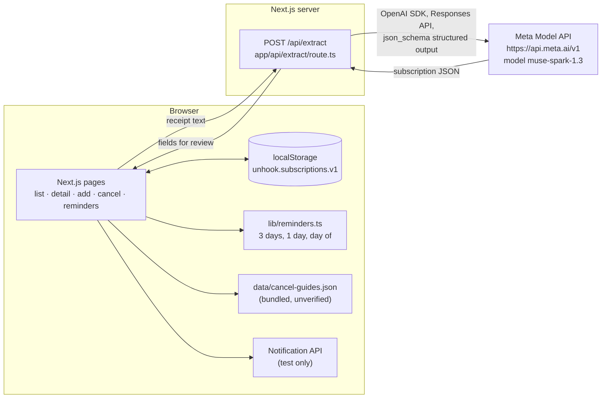

# Unhook

An AI assistant that keeps track of your subscriptions and free trials so nothing renews unnoticed.

Paste a receipt or checkout page, and Unhook uses Meta's Muse Spark model to pull out the service, price, billing period, and trial dates. You review the details and save them. Unhook then shows what you pay per month and per year, warns you before trials end, lists upcoming reminders, and shows the steps to cancel.

Built for the **Meta Global AI Developer Hackathon** (Indie Developer Track), Oct 27 to Nov 4, 2026.

## Architecture



Only the receipt text you paste leaves the browser, and it goes through the app's own `/api/extract` route. The API key stays on the server. Saved subscriptions never leave the browser.

## Features

- **Subscription list**: sorted by next renewal, with monthly and yearly totals per currency. Cancelled subscriptions are excluded, and trials count at full price. A "Trial ending soon" badge appears when a trial ends within 3 days.
- **Add from a receipt**: paste receipt or checkout text, extract the details with Muse Spark, review them, edit, and confirm. You can also enter everything by hand.
- **Review step**: when the extraction returns a confidence below 80% or lists issues, a "Needs review" banner lists each issue and highlights the fields it mentions. A small indicator shows the confidence, or "unknown" when there is none. Older responses without these fields still work.
- **Detail and edit page**: change price, billing period, dates, notes, and reminder channel, or mark a subscription as cancelled. The next renewal date and trial status are recalculated.
- **Cancel guides**: steps and a help link for 25 common services, matched by name.
- **Reminders page**: the reminders due in the next 7 days, plus a "Test notification" button.
- **Installable**: a web app manifest with SVG icons.
- **Responsive and accessible**: works at 375px width, with visible focus rings, a skip link, labelled controls, and clear empty, loading, and error states.

## Tech stack

- [Next.js](https://nextjs.org) 16.4.3 (App Router, Cache Components), React 19.3, TypeScript
- Tailwind CSS v4
- [`openai`](https://www.npmjs.com/package/openai) Node SDK, pointed at the Meta Model API
- Node's built-in test runner (`node:test`) for the pure logic
- Browser `localStorage` for data and the browser Notification API for the test notification

## Setup

You need Node.js. `npm test` needs Node 22.18 or newer, because the tests import TypeScript files directly. On Node 22.6 to 22.17, add `--experimental-strip-types` to the test script.

```bash
git clone https://github.com/samuelbukumni/unhook.git
cd unhook/web
npm install
```

Create `web/.env.local` with your Meta Model API key (see `web/.env.example`). The file is git-ignored, so never commit it.

```
MODEL_API_KEY=your-key-here
```

Then run the app:

```bash
npm run dev     # http://localhost:3000
npm run lint
npm test
npm run build
```

Optional: `scripts/first-call.mjs` at the repo root was the first test call to the API. To run it, run `npm install` at the root, put `MODEL_API_KEY=` in a root `.env` file, and then run `node --env-file=.env scripts/first-call.mjs`.

## Demo script (60 seconds)

1. **Add** → paste the sample receipt below → **Extract details**.
2. Point out the confidence badge and any highlighted "Check" fields, then
   **Confirm and save**.
3. Home — the new subscription in the list with cost totals.
4. **Reminders** — upcoming trial ends and renewals for the next 7 days.
5. Open the subscription → edit a field → **How to cancel** — guide steps
   + official link.

Sample receipt to paste:

```text
From: billing@streamnest.example
Subject: Your StreamNest receipt

Thanks for your payment!
Plan: Basic
Amount: $9.99
Billing period: Monthly
Charged on: October 5, 2026
```

## How Meta's models are used

All model calls go through one server route, [`web/app/api/extract/route.ts`](web/app/api/extract/route.ts):

1. The browser sends `POST /api/extract` with `{ "text": "..." }`. The route rejects empty text and anything over 8,000 characters.
2. The route uses the OpenAI Node SDK with `baseURL: "https://api.meta.ai/v1"` and the key from `process.env.MODEL_API_KEY`. It calls the **Responses API** (`client.responses.create`) with model **`muse-spark-1.3`**.
3. The instructions give today's date, ask for `YYYY-MM-DD` dates, ask the model to work out trial dates from today when only a length is given, ask for `null` when a value is unknown, and say never to guess a price.
4. The response is constrained with **structured output**: `text.format` of type `json_schema`, with `strict: true` and a schema for `service`, `plan`, `price`, `currency`, `billing_period` (`weekly`, `monthly`, `yearly`, `one_time`, or `unknown`), `trial_end_date`, `first_charge_date`, and `notes`.
5. The route parses `output_text` as JSON. If the call or the parsing fails, it logs the error on the server and returns `502` with `{ "error": "Extraction failed." }`. If `MODEL_API_KEY` is missing, it returns `500` with a setup explanation instead.
6. The extraction is checked twice before it reaches the user: deterministic code checks (service name and price appear in the text, valid dates, charge after trial end) plus a second strict model call that verifies each field against the source text. The route returns a `confidence` score (0 to 1) and an `issues` list alongside the fields.

Calls are rate-limited in memory (10 requests per 10 minutes per IP in production).

On the client, [`web/lib/extraction.ts`](web/lib/extraction.ts) checks the response shape. It also accepts the optional `confidence` (0 to 1) and `issues` (list of strings) fields and ignores them when they are malformed. Nothing is saved until the user reviews the form and confirms.

## What was built during the hackathon

Everything in this repository was created during the event. These entries come from the git log, with times in Africa/Lagos (UTC+1).

- **Oct 27**: repository created.
- **Oct 29**: initial README and `.env.example`. First Muse Spark call (`scripts/first-call.mjs`) extracting subscription details from a sample receipt.
- **Oct 30, 02:57**: Next.js app scaffolded in `web/`.
- **Oct 30, 03:25**: `/api/extract` route using Muse Spark with structured output.
- **Oct 30, 03:31 to 03:46**: subscription list and cost totals, detail and edit page, localStorage storage layer, `/add` page with receipt extraction and manual form, cancel guides and cancel page, reminder logic with tests, and 20 test receipts.
- **Oct 31**: review step for low-confidence extractions, `/reminders` page with a test notification, demo mode controls, responsive and accessibility polish, web app manifest and icons, and this README.
- **Nov 3**: pre-submission review fixes (missing-key error, date validation, crash guards), demo-mode removal, UI polish, and a demo script in this README.

## Built with Grok

Some of the code was scaffolded with Grok, an AI coding assistant, and reviewed by Samuel before merging. In the git history, these commits are authored by **Grok Bot**. The Oct 31 commits also start with `[grok]`. They cover:

- the subscription list, detail and edit page, storage layer, `/add` flow, cancel guides, reminder logic and tests, and test receipts (Oct 30)
- the review step, reminders page, demo mode, UI polish, web app manifest, and this README (Oct 31)

Samuel wrote the original idea and plan, the first Muse Spark call, the Next.js scaffold, and the `/api/extract` route that calls Meta's model. He also set the task list and rules for Grok's work.

## Limitations

- **Cancel guides are unverified.** All 25 guides in `web/data/cancel-guides.json` are marked `verified: false`. The steps and links haven't been checked by hand and may be out of date, and the app says so on every guide.
- **No browser extension.** Capturing a subscription straight from a checkout page is planned but not built. For now you paste the text.
- **localStorage only.** There are no accounts, sync, or server database. Data stays in one browser and is lost if site data is cleared.
- **Notifications are a test only.** The "Test notification" button shows one notification through the browser Notification API. No reminders are scheduled or pushed, and the "Email" reminder channel is only stored, not sent.
- **No service worker.** The app can be installed but doesn't work offline. Some mobile browsers only show notifications from a service worker, so the test button may not work there.
- **SVG-only icons.** Some platforms, such as iOS home screen icons and some Android installs, need PNG icons, which aren't included yet.
- **AI extraction can be wrong.** That's why every extraction goes through a review step before saving.
